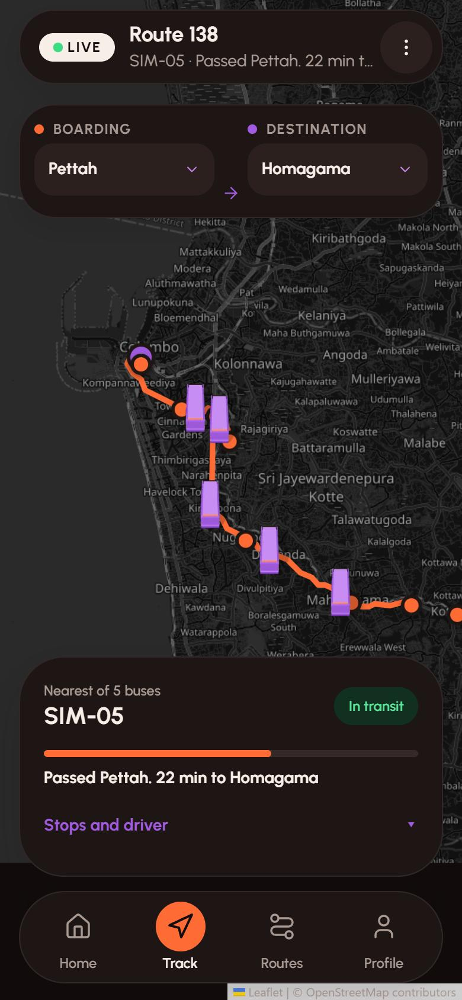
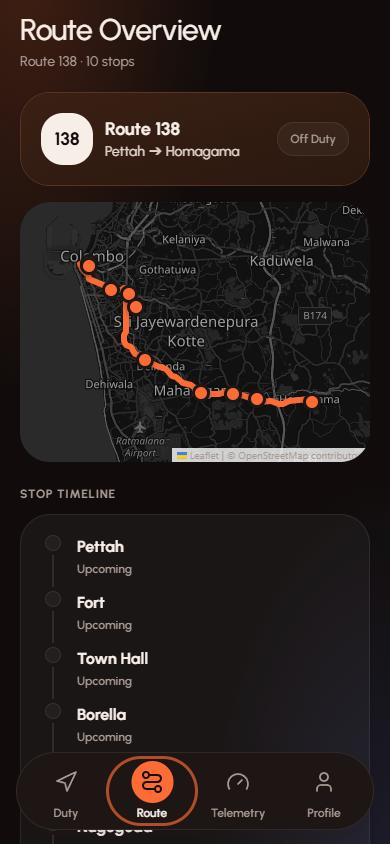
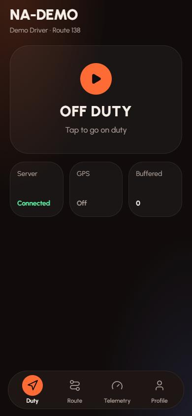
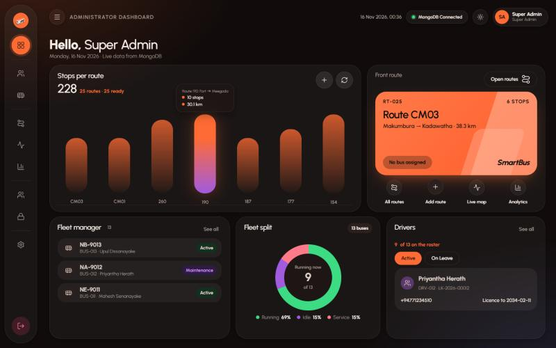
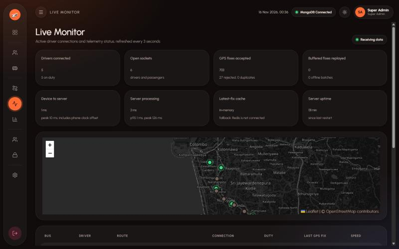
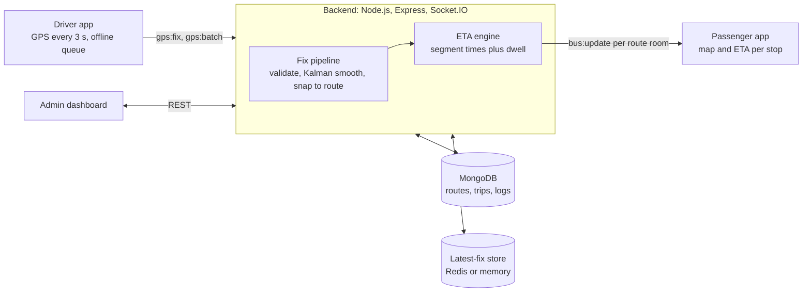

# Smart Bus Tracking and Arrival Prediction System

[](https://github.com/nadunkanishka/Smart-bus-tracking-system/actions/workflows/ci.yml)
[](https://sonarcloud.io/summary/new_code?id=nadunkanishka_smart-bus-tracking-system)


[](LICENSE)

Live bus tracking for Sri Lanka's public bus network, with no hardware in the bus: the driver's own phone is the tracker. Passengers watch the bus move on a map with an arrival time for every stop, and an admin manages routes, buses and drivers. Final-year project, BEng (Hons) Software Engineering.

<p align="center">
  
  &nbsp;
  
  &nbsp;
  
</p>
<p align="center">
  
  
</p>

**Live:** [admin dashboard](https://smartbusadmin.vercel.app) · [passenger web app](https://smartbuspassenger.vercel.app) · [API health](https://smart-bus-tracking-system-production.up.railway.app/api/health) (backend on Railway, database on MongoDB Atlas, the two phone apps as Android builds).

## What it does

- **Driver app:** sign in with the bus, go on duty, and send a GPS position every 3 seconds. When the signal drops, positions are queued and sent in order when it returns, without loss or duplicates.
- **Passenger app (phone and web):** pick a route and your stops, see every bus on a map, and read the predicted arrival at each stop. Your usual journey is remembered.
- **Admin dashboard:** routes with a map editor (road path and stops), buses (many to a route, one route per bus), drivers, passengers and administrators, with search and status filters; a live monitor of connections and delivery latency; ETA accuracy and segment-time analytics; light and dark mode.
- **Backend:** validates and smooths each fix, predicts arrival times from the route's own history, and pushes updates to the passengers on that route over Socket.IO.

## How it works



[docs/ARCHITECTURE.md](docs/ARCHITECTURE.md) has the full component diagram, the realtime sequence, the ETA flow and the hosting and delivery pipeline. [docs/DESIGN-DECISIONS.md](docs/DESIGN-DECISIONS.md) explains the choices and what each costs.

## Tech stack

| Layer | Technology |
|---|---|
| Backend | Node.js 22, Express 5, Socket.IO, Mongoose, optional Redis, JWT with scrypt-hashed passwords, helmet, rate limiting |
| Admin dashboard | React (Create React App), Leaflet, anime.js |
| Phone apps | Expo SDK 57, React Native, a map drawn by the app on Esri tiles (no map key), EAS Build and EAS Update |
| Shared | One contract (events, statuses, ids, timing) and one design system, generated into every client and checked in CI |
| Data | MongoDB with 2dsphere indexes and a 14-day TTL on raw GPS |
| Hosting | MongoDB Atlas, Railway, Vercel (all on free tiers for the pilot) |
| Quality | ESLint, 195 automated tests, GitHub Actions CI with MongoDB and Redis services, SonarCloud |

## Results so far

Measured with the replay simulator on one machine (simulated buses, not real traffic), so they show the system's behaviour, not field accuracy. A real pilot ride has not been run yet.

| Measure | Result | How to reproduce |
|---|---|---|
| Delivery, phone to passenger | 10 buses, 500 fixes sent, 500 received; **average 4 ms, p95 3 ms, peak 130 ms** | `npm run replay -- --route RT-001 --buses 10 --duration 150 --quiet` |
| GPS smoothing, 15 m noise (Route 141, simulated track) | Position error **15.6 m to 11.9 m**; at a stop **18.8 m to 7.4 m** | `node scripts/smoothing-eval.js 141` |

Method, caveats and the load test are in [docs/EVALUATION.md](docs/EVALUATION.md).

## Quick start

With MongoDB installed and running locally:

```bash
git clone https://github.com/nadunkanishka/Smart-bus-tracking-system.git
cd Smart-bus-tracking-system
npm run install:all      # backend, admin dashboard and both apps
npm run dev:backend      # http://localhost:5000 (a second terminal for the rest)
npm run seed             # 25 Colombo routes with real road lines
npm run dev:admin        # http://localhost:3000, sign in as admin / admin123
```

Or the whole backend with Docker (API, MongoDB and Redis): `docker compose up --build`, then `docker compose exec api node scripts/seed.js`.

To try it without a phone, make simulated buses drive a route: `cd backend && npm run replay -- --route RT-001 --buses 3 --duration 120`. The passenger and driver apps run in the browser or in Expo Go: `npm run dev:passenger`, `npm run dev:driver`. Step by step, with troubleshooting: [docs/SETUP-LOCAL.md](docs/SETUP-LOCAL.md).

## Testing and CI

```bash
npm run check     # ESLint, then backend, admin dashboard and app tests
```

| Suite | Tests | Covers |
|---|---|---|
| Backend (`node --test`) | 90 | ETA engine, Kalman smoothing, fix pipeline, trip tracker, latest-fix store (memory and Redis), auth, and the REST and Socket.IO API on a real server with a throwaway database |
| Admin dashboard (Jest) | 57 | Sign-in flow, entity forms, list search and filters, account pages, API client |
| Apps (`node --test`) | 48 | Telemetry decisions, bus selection, saved journey, map maths, the shared UI kit's rules |

GitHub Actions runs lint, the backend against real MongoDB and Redis, the admin tests and production build, the app tests, both apps bundled for web and Android, and a check that the generated copies of `shared/` are current. SonarCloud analyses every pull request.

## Project layout

| Folder | Contents |
|---|---|
| `backend/` | API server: `routes/`, `realtime.js`, `lib/` (fix pipeline, ETA, smoothing, store), `models/`, `test/` |
| `apps/admin-dashboard/` | React admin web app |
| `apps/driver-app/`, `apps/passenger-app/` | The two Expo apps |
| `shared/` | The contract and the design system, copied into every client by `npm run sync` |
| `docs/` | [Documentation index](docs/README.md): architecture, API, database, evaluation, setup and deployment guides |
| `loadtest/` | Artillery load test |

## Limitations and next steps

- The driver app tracks while it is open and the screen is awake. Tracking with the screen off needs Android's foreground service, which crashed an installed build and is switched off until it is verified on a phone.
- ETA and latency figures above are simulated. Field figures need pilot rides with real traffic, and the stop-to-stop history improves with every trip.
- A route is one direction of travel; a bus driving back is modelled as its own route.
- The latest-fix store runs in memory on the free hosting; more than one API instance needs Redis.
- Next: a pilot on Route 138 (Pettah to Homagama), a user study, Redis hosting, background tracking, Play Store release.

More in [docs/ARCHITECTURE.md](docs/ARCHITECTURE.md#known-limits).

## License

[MIT](LICENSE) © 2026 Nadun Kanishka
