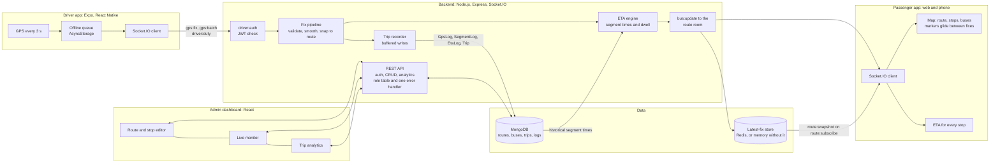
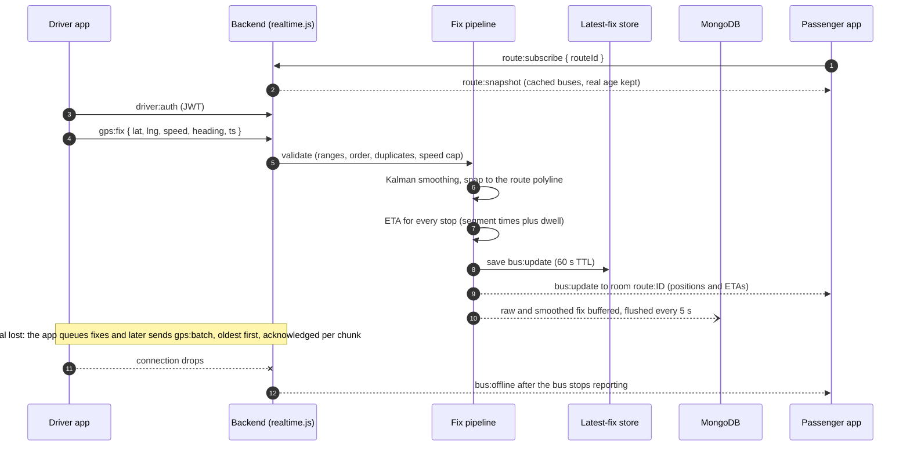
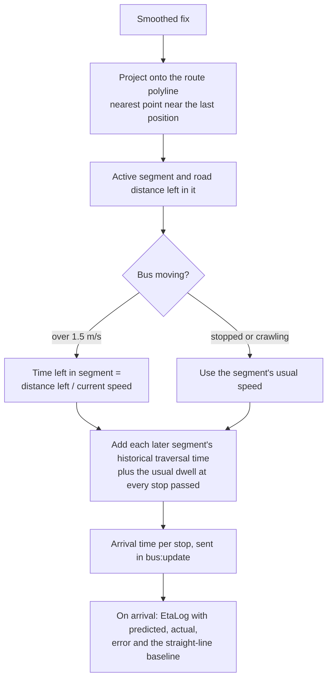
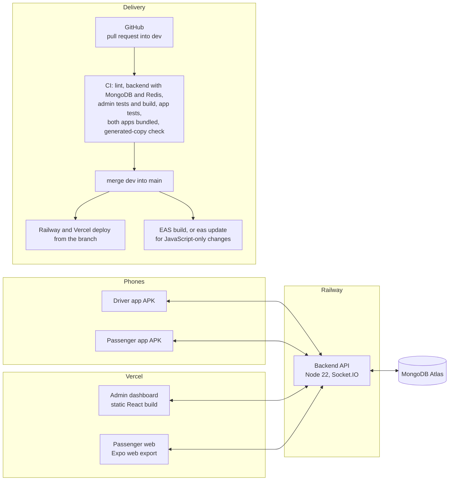

# System architecture

Smart Bus Tracking and Arrival Prediction System: three client tiers around one Node.js backend. A driver's phone is the only tracking hardware.

The same tiers over time, for one GPS fix:

## Data flow for one GPS fix

1. The driver app captures a position every 3 seconds while on duty and emits `gps:fix` (`lat`, `lng`, `speed` in m/s, `heading`, `accuracy`, `ts` device time in ms, `seq`).
2. `backend/realtime.js` receives it on the bus's socket and hands it to the fix pipeline (`backend/lib/fixPipeline.js`), which validates it (`lib/validate.js`): coordinate ranges, a required timestamp that is not in the future or older than a day, a plausible speed. A fix whose timestamp is not newer than the bus's last accepted fix is dropped as a duplicate or out-of-order fix, a live fix less than 0.9 s after the last one as too frequent, and a fix implying an impossible jump is rejected.
3. Unless `GPS_SMOOTHING=off`, a smoothing filter (`backend/lib/smooth.js`) steadies the raw position. The ETA, the map marker and `GpsLog.smoothed` use the smoothed point. `GpsLog.location` keeps the raw fix.
4. The ETA engine (`backend/lib/eta.js`) computes the arrival time at every stop (see below), on the route prepared by `lib/routeCache.js` (geometry plus history, re-read every 5 minutes or when the route or its history changes). `lib/tripRecorder.js` writes the trip history.
5. The result is written to the latest-fix cache (`bus:<busId>:last`, 60 s TTL) and emitted as `bus:update` to the Socket.IO room `route:<routeId>`.
6. The raw fix is appended to an in-memory buffer (`lib/tripRecorder.js`) that is written to MongoDB (`GpsLog`) every 5 seconds, so the live path never waits on a database write.

Counters, latency samples and the admin's live list are kept by `lib/metrics.js`. Every threshold and time window is named in `lib/limits.js` (server only) or `lib/contract.js` (shared with the apps), with how they relate written down there.

A passenger who selects a route emits `route:subscribe`. The server moves the socket into that route's room and replies with `route:snapshot`, read from the cache, so the map shows buses immediately.

## ETA engine

Each route has a road polyline and an ordered list of stops. Consecutive stops define segments. For each fix:

| Step | What happens | Code |
|---|---|---|
| (a) | Project the position onto the nearest point of the polyline | `projectOntoLine` in `lib/geo.js` |
| (b) | Find the active segment and the road distance left in it | `computeEta` |
| (c) | Time for the current segment = remaining distance / current speed. If the bus is stopped or crawling (under 1.5 m/s), the segment's usual speed is used | `computeEta` |
| (d) | For each later segment add its historical average traversal time, plus the average dwell time at each stop passed on the way | `computeEta` |

Historical values are averages of `SegmentLog` records for that route and segment. A segment with no history uses 20 km/h and a 20 second dwell. Distances follow the road polyline, not a straight line between points.

## Trip history and evaluation data

The trip tracker (`lib/tripTracker.js`, pure) watches each bus's progress and `lib/tripRecorder.js` stores what it reports:

- When a bus crosses from one segment to the next it writes a `SegmentLog` (traversal seconds, dwell seconds). Dwell is time spent under 1.5 m/s within 40 m of a stop. A segment the bus joined part-way is not logged.
- When a bus leaves a stop, the predicted arrival at every later stop is remembered. On arrival an `EtaLog` is written with predicted time, actual time and the error.
- A trip ends in one place (`endTrip`). `Trip.completed` is true only when the bus reached the final stop; a trip closed by going off duty, by starting again near the first stop, or by a route change is not completed.

## Offline buffer

If the connection drops, the driver app queues fixes (persisted in AsyncStorage, capped at 2000, about 100 minutes). On reconnect it sends them oldest-first as `gps:batch` in chunks of 500 and removes a chunk only after the server acknowledges it. If an acknowledgement is lost the chunk is sent again and the server discards the repeats by timestamp. Buffered fixes update trip history, but only the newest fix of a batch is shown to passengers.

## Authentication

Passwords are stored as scrypt hashes; a legacy plaintext password is replaced by its hash on the first successful sign-in (admin, bus and passenger alike). The credential rules (username patterns, password minimums: 8 for admins, 6 for passengers, token lifetimes) are in `lib/accounts.js`. Which role each REST path needs is one table, `middleware/access.js`. Login returns a JWT with a `role` claim (`admin`, `driver` or `passenger`). Admin REST endpoints require an admin token. Driver sockets must present a driver token before `gps:fix` is accepted. Reading routes and subscribing to a route room are open.

## Hosting and delivery

A change goes to `dev` through a pull request; CI must be green. `main` is what gets built and shipped. A JavaScript-only change reaches installed phone apps with `eas update` (no rebuild, the app is kept); a native change (a new native package, a permission, the icon) needs a new build, and its version code rises by itself so it installs over the old app. See [SETUP-APKS.md](SETUP-APKS.md).

## Design

The two phone apps share one flat "Studio" skin, and the admin dashboard has its own; both read the same contract and component logic. The reasoning is in [DESIGN-DECISIONS.md](DESIGN-DECISIONS.md#two-skins-one-contract) and the token files are described in [shared/README.md](../shared/README.md).

## Known limits

- The in-process bus state (trip progress, last fix) lives in one server process. Running several API instances would need that state moved into Redis and the Socket.IO Redis adapter.
- A route that crosses or doubles back on itself is handled by searching near the bus's last position, which assumes fixes arrive regularly.
- The driver app tracks while it is open, with the screen kept awake. Tracking with the screen off needs Expo's Android foreground service, which crashed the installed build, so it is switched off (`BACKGROUND_TRACKING` in `apps/driver-app/src/services/telemetry.js`) until it is verified on a phone.
- A route is one direction of travel. A bus driving back along the same road is projected onto the outbound path, so its stop ETAs are wrong until it is near the first stop again. Model the return leg as its own route and assign the bus to it for the return trip.
- Going off duty closes the open trip and resets the bus's position state. The next duty period starts a new trip.
- Passengers have no password reset: there is no email or SMS channel to send one to, so an admin would have to reset it.
- A deleted admin's token stays valid until it expires (12 h). A deleted passenger's token (30 days) is refused by `/me` but passes other checks. The admin guard checks the token only, not the database.
- Deleting a route or bus keeps its trip, GPS, segment and ETA logs, so logs can refer to ids that no longer exist.
- A bus belongs to one route (`Bus.routeId`, enforced by the server with a 409); a route can have many buses.
- A bus on duty keeps streaming after it is deleted or its route changes, until the driver signs in again. On that sign-in the server sees the new route in the token, takes the bus off the old route's map (`bus:offline`) and publishes to the new route only.
- Lists are not paginated or searchable.
- The admin role is free text. Every admin can do everything.
